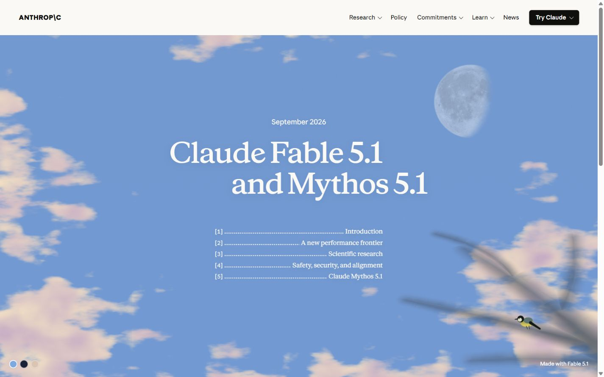

# Anthropic Article · Anthropic 文章页

Claude Fable 5.1 & Mythos 5.1 发布页的学习复刻（首页 + Introduction）。

参考页面：[Anthropic 发布页](https://www.anthropic.com/claude-fable-and-mythos-5-1)



按 `dulk-dev/my-shares`《用AI复刻一个复杂动效网站的思路》的方法复刻：
Playwright 侦察取证 → /duck 逐模块落盘分析 → /web-shader-extractor 场景锁定与重建 → 自运行 + 截图对比 QA。

## 运行

```bash
git clone https://github.com/Lake-Evendim/anthropic-article.git
cd anthropic-article
python -m http.server 8000 --bind 127.0.0.1
# 打开 http://localhost:8000
```

## 范围

- ✅ 首屏：SiteHeader、LaunchHero（标题/目录/色板/credit）、WebGL 场景（天空/云/月/星/树枝/山雀/Time-of-day）
- ✅ Introduction 章节（导语 + 5 段）
- ❌ 其余章节、footer、移动菜单、下拉交互（见 analysis/known-gaps.md）

## 目录

```
index.html            页面结构
css/main.css          设计令牌 + 布局（令牌值取证自原站 CSS）
js/hero-scene.js      场景引擎（原创 GLSL 重建，createFableHero API）
assets/               本地字体、月面、树皮和云噪声（来源见 assets/README.md）
js/main.js            胶水层（入场闩/shelters/顶栏/侧栏）
analysis/             分析文档（duck 走查 + 逐模块 + known-gaps）
docs/                 首屏预览图
.web-shader-extractor/ 本地侦察产物（不纳入 Git 仓库）
```

2026-11-13 首屏场景优化：云层、月亮、树枝与山雀已重建，并修正昼夜过渡及手机横向溢出。随后进一步完善月面、体积云、树皮材质及 Anthropic 字体。详情见 `analysis/06-hero-refinement.md` 和 `analysis/07-materials-and-typography.md`。

## 重要声明

- 文本与页面结构为对目标页面的复刻练习；场景引擎为原创重建。本轮使用参考页 AnthropicSans/Serif 字体及树皮颜色/法线纹理，月面使用 NASA LRO/LROC 数据；来源见 `assets/README.md`，实现差异见 `analysis/known-gaps.md`。
- 参考页字体和树皮资产的开放再分发许可未核实；不将它们声明为本项目自有或开放授权资产。
- 本项目为学习复刻，非 Anthropic 官方页面；第三方内容与资源的权利归其各自所有者，使用或再分发前需核实其授权。
